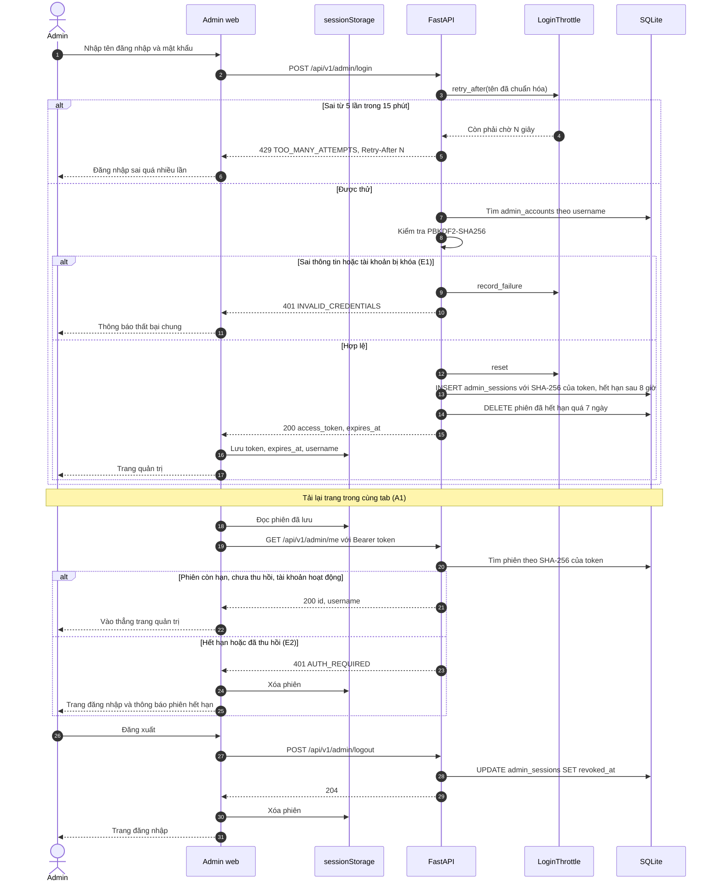
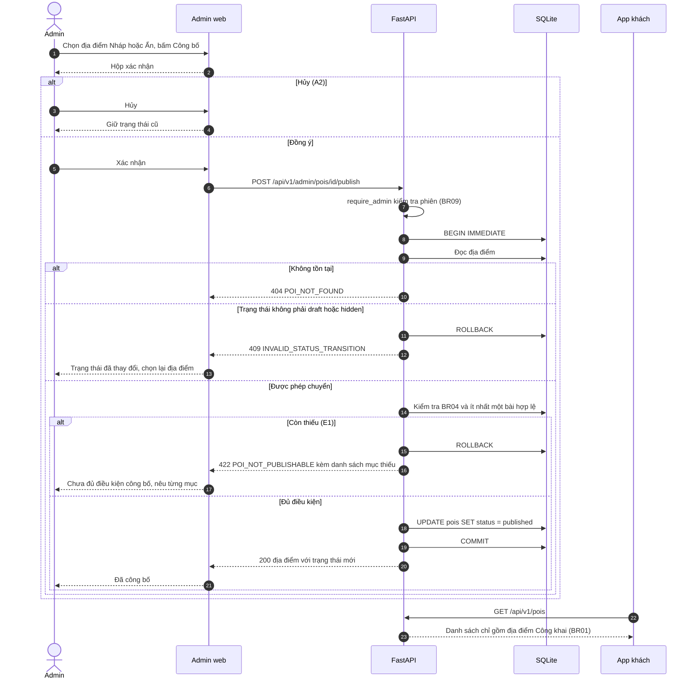
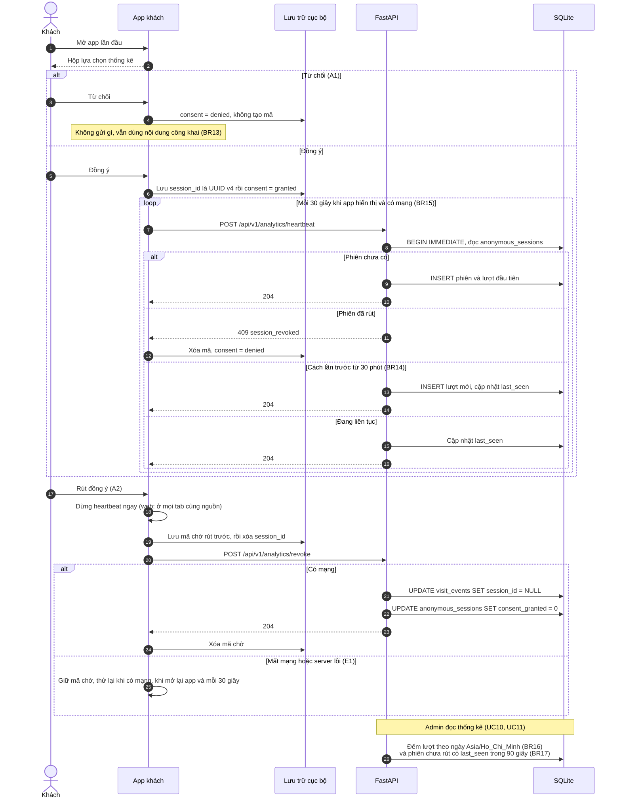
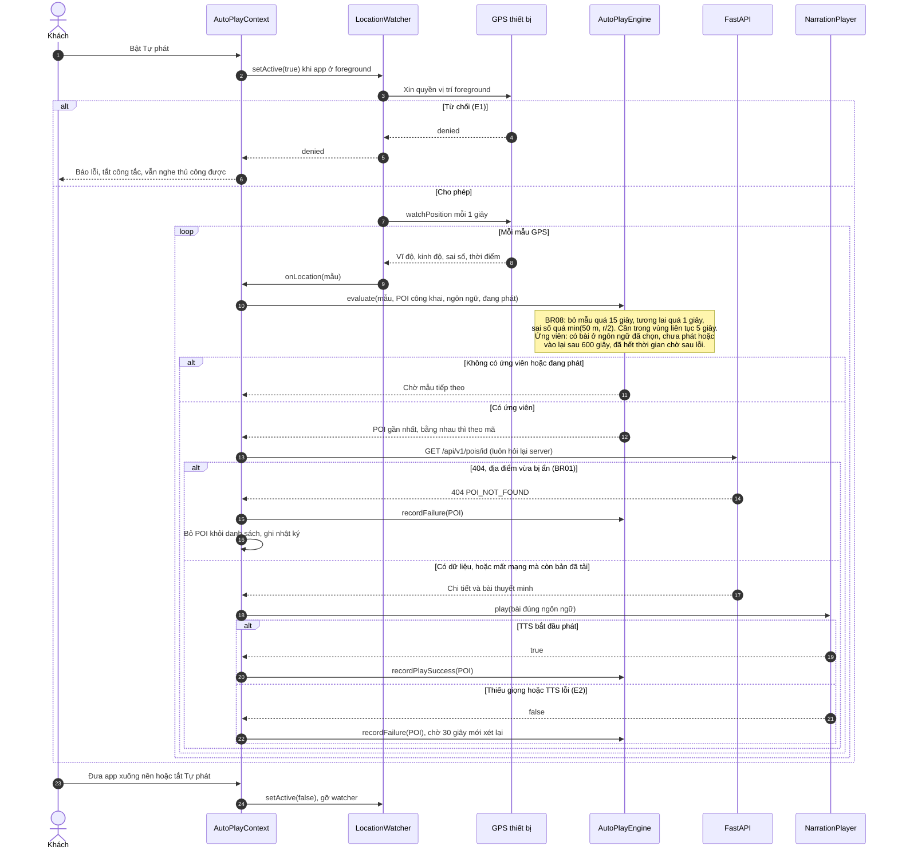

# Sơ đồ tuần tự

Bốn luồng chính, vẽ theo mã nguồn `main` ngày 09/11/2026 (không phải thiết kế dự kiến). Nguồn Mermaid nằm ngay trong tệp này; GitHub hiển thị trực tiếp. Để đưa vào báo cáo Word, dán từng khối vào <https://mermaid.live> rồi xuất PNG/SVG.

| Sơ đồ | Use case | Quy tắc |
| --- | --- | --- |
| [SD-01 Đăng nhập, khôi phục phiên, đăng xuất](#sd-01--đăng-nhập-khôi-phục-phiên-đăng-xuất-uc05) | UC05 | BR09, BR10, NFR01 |
| [SD-02 Công bố địa điểm](#sd-02--công-bố-địa-điểm-uc09) | UC09 | BR01, BR03, BR04, BR12 |
| [SD-03 Đồng ý, heartbeat và rút đồng ý thống kê](#sd-03--đồng-ý-heartbeat-và-rút-đồng-ý-thống-kê-uc12) | UC12, UC10, UC11 | BR13–BR18 |
| [SD-04 Tự động phát theo GPS](#sd-04--tự-động-phát-theo-gps-uc04) | UC04 | BR01, BR05, BR07, BR08 |

## SD-01 — Đăng nhập, khôi phục phiên, đăng xuất (UC05)

Mã: `backend/app/api/routes/auth.py`, `backend/app/services/auth.py`, `backend/app/services/login_throttle.py`, `apps/admin-web/src/features/admin/auth/Admin.jsx`, `apps/admin-web/src/services/session.js`.

## SD-02 — Công bố địa điểm (UC09)

Mã: `backend/app/api/routes/admin_pois.py` (`change_status`, `publish_problems`), `apps/admin-web/src/features/admin/places/PublicationPanel.jsx`. Kiểm tra điều kiện và đổi trạng thái nằm trong cùng giao dịch `BEGIN IMMEDIATE`, nên hai yêu cầu đồng thời chỉ một yêu cầu thành công.

## SD-03 — Đồng ý, heartbeat và rút đồng ý thống kê (UC12)

Mã: `apps/guest-web/src/features/privacy/analyticsClient.js`, `apps/mobile/src/features/privacy/AnalyticsClient.js`, `backend/app/api/routes/analytics.py`, `backend/app/services/analytics_service.py`. Mỗi heartbeat được xử lý trong một giao dịch `BEGIN IMMEDIATE` để các request đồng thời không tạo trùng lượt (BR14).

## SD-04 — Tự động phát theo GPS (UC04)

Mã: `apps/mobile/src/features/location/` (`AutoPlayContext.js`, `locationWatcher.js`, `autoPlayEngine.js`, `freshDetail.js`), `apps/mobile/src/features/narration/NarrationPlayer.js`. Tọa độ chỉ nằm trong bộ nhớ của engine, không lưu và không gửi đi (BR07).

